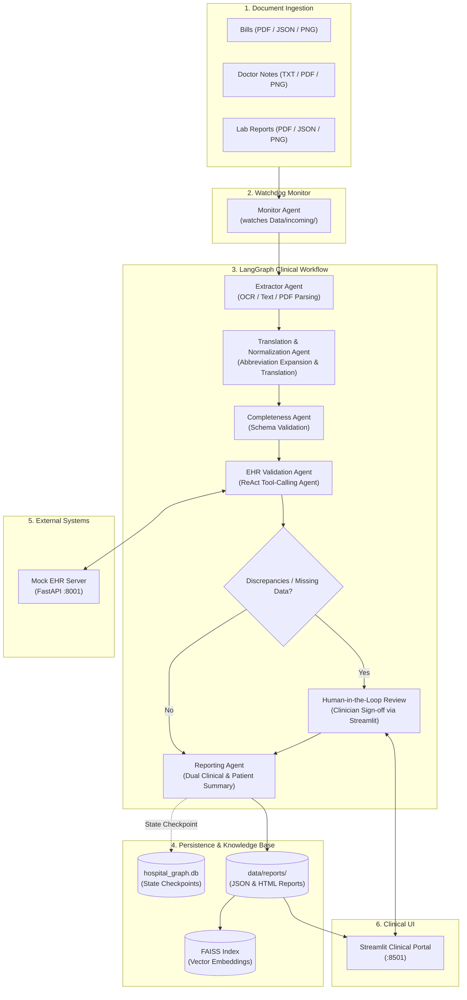

# 🏥 Agentic AI System for Automated Hospital Discharge Summaries

[](https://www.python.org/downloads/)
[](https://github.com/langchain-ai/langgraph)
[](https://streamlit.io/)
[](https://fastapi.tiangolo.com/)
[](LICENSE)

An intelligent, autonomous multi-agent clinical documentation pipeline that ingests multimodal hospital records (physician notes, lab reports, billing invoices in PDF, PNG OCR, JSON, and TXT), harmonizes clinical entities, cross-verifies against Electronic Health Records (EHR) with Human-in-the-Loop (HITL) safety, and automatically synthesizes comprehensive discharge summaries and patient-friendly explanations.

---

## 📑 Table of Contents

- [Key Capabilities](#-key-capabilities)
- [System Architecture](#-system-architecture)
- [Agent Ecosystem](#-agent-ecosystem)
- [Project Structure](#-project-structure)
- [Prerequisites & Installation](#-prerequisites--installation)
- [Environment Configuration](#-environment-configuration)
- [Running the System](#-running-the-system)
- [Clinical Web Portal](#-clinical-web-portal)
- [Testing](#-testing)
- [Clinical Disclaimer](#-clinical-disclaimer)

---

## 🌟 Key Capabilities

1. **Multimodal Document Ingestion & Extraction**:
   - Ingests structured JSON/TXT notes, complex scanned PDFs (via PyMuPDF), and image-based lab reports (via Tesseract OCR).
   - Autonomous directory monitoring triggers the pipeline once all required document streams arrive.

2. **Multilingual Translation & Clinical Normalization**:
   - Translates non-English clinical text while strictly preserving medical semantics.
   - Expands cryptic hospital abbreviations and standardizes medical entities against clinical coding standards.

3. **Canonical Consolidation & Schema Validation**:
   - Synthesizes fragmented doctor, lab, and billing data into a single canonical patient record validated against a standardized clinical JSON schema.

4. **Human-in-the-Loop (HITL) EHR Verification**:
   - ReAct agent queries the hospital's EHR server to verify diagnoses, lab values, and medication histories.
   - Clinical discrepancies and discrepancies between records trigger an interactive clinician review before finalization.

5. **Physician & Patient Discharge Reporting**:
   - Generates dual-audience summaries: an exhaustive clinical report for healthcare providers and an accessible, plain-English summary for patients and caregivers.
   - Exports reports in structured JSON and styled HTML formats.

6. **Hybrid RAG Clinical Q&A Assistant**:
   - FAISS vector database coupled with an intelligent query router (Structured Query vs. Semantic Vector Search) for instant medical chart querying and audit trails.

---

## 🏗️ System Architecture



---

## 🤖 Agent Ecosystem

| Agent | Module | Description |
| :--- | :--- | :--- |
| **Monitor Agent** | [`agents/monitor_agent.py`](agents/monitor_agent.py) | Continuously monitors input folders using `watchdog` to stage incoming patient documents. |
| **Extractor Agent** | [`agents/extractor_agent.py`](agents/extractor_agent.py) | Extracts text from PDFs (PyMuPDF), scans/images (Tesseract OCR), and structured files. |
| **Translation & Normalization** | [`agents/translation_normalization_agent.py`](agents/translation_normalization_agent.py) | Translates foreign languages to English and standardizes medical terms and dosage abbreviations. |
| **Completeness Agent** | [`agents/completenss_agent.py`](agents/completenss_agent.py) | Validates extracted data against canonical JSON rules (`configs/rules.json`). |
| **EHR Validation Agent** | [`agents/ehr_validation_agent.py`](agents/ehr_validation_agent.py) | LangChain ReAct agent executing API tools against the EHR server to cross-verify clinical facts. |
| **Human Review Agent** | [`agents/human_review.py`](agents/human_review.py) | Facilitates physician-in-the-loop review for discrepancies, flags, or missing records. |
| **Reporting Agent** | [`agents/reporting_agent.py`](agents/reporting_agent.py) | Generates professional discharge reports in JSON and HTML. |
| **RAG Assistant & Indexer** | [`agents/rag_agents/`](agents/rag_agents/) | Indexes finalized discharge summaries into FAISS and provides hybrid clinical Q&A. |

---

## 📁 Project Structure

```text
.
├── agents/                           # Clinical Agent definitions
│   ├── rag_agents/                   # Retrieval-Augmented Generation subsystem
│   │   ├── augmentation_agent.py     # Prompt augmentation agent
│   │   ├── generation_agent.py       # Clinical answer generation
│   │   ├── indexing_agent.py         # FAISS vector store indexer
│   │   ├── reflection_agent.py       # Hallucination & factual verification
│   │   ├── retrieval_agent.py        # Vector similarity search
│   │   ├── router_agent.py           # Hybrid query router
│   │   └── structured_query_agent.py # Direct structured report search
│   ├── completenss_agent.py          # Schema validation agent
│   ├── ehr_validation_agent.py       # ReAct tool-calling agent
│   ├── extractor_agent.py            # Multimodal document parser & OCR
│   ├── human_review.py               # Human-in-the-Loop handler
│   ├── llm.py                        # Unified LLM provider & gateway factory
│   ├── monitor_agent.py              # Directory watcher
│   ├── reporting_agent.py            # Clinical report generator
│   ├── router_integration.py         # Intelligent model routing integration
│   ├── router_monitoring.py          # Provider latency & cost monitoring
│   ├── routing_strategy.py           # Adaptive model selection strategy
│   └── translation_normalization_agent.py # Multilingual & abbreviation agent
├── configs/                          # Agent personas, schemas & rules
│   ├── persona_clinical_agent.yaml   # Detailed agent prompt personas
│   ├── rules.json                    # Canonical patient JSON schema
│   └── rules.yaml                    # Validation rules
├── Data/                             # Input documents & generated data
│   └── incoming/                     # Patient source documents
│       ├── bills/                    # Medical bills (JSON, PDF, PNG)
│       ├── doctor_reports/           # Clinical notes (TXT, PDF, PNG)
│       └── lab_reports/              # Pathology & lab results
├── examples/                         # Usage patterns & routing demonstrations
│   └── router_usage_example.py
├── gateway/                          # LiteLLM intelligent proxy gateway
│   ├── gateway.py                    # Gateway service
│   └── litellm_config.yaml           # Model mappings & routing configuration
├── langgraph_workflows/              # StateGraph clinical workflow
│   ├── graph.py                      # LangGraph graph definition
│   └── state.py                      # TypedDict state schemas
├── mock_ehr/                         # Mock Electronic Health Records service
│   ├── app.py                        # FastAPI endpoints (:8001)
│   └── data.py                       # Simulated patient EHR database
├── ui/                               # Streamlit Web Application
│   ├── ehr_review.py                 # EHR validation review tab
│   ├── final_report.py               # Report viewer & downloader tab
│   ├── qa_assistant.py               # Interactive RAG Q&A chat
│   ├── streamlit_app.py              # Main dashboard entrypoint
│   ├── upload_documents.py           # Document upload & staging tab
│   └── validation.py                 # Schema validation review tab
├── .env.example                      # Template for environment variables
├── .gitignore                        # Git ignore rules
├── main.py                           # Application entrypoint (Gateway + Monitor)
├── requirements.txt                  # Python package dependencies
├── setup.py                          # Package setup configuration
└── test_omnirouter.py                # Gateway & model verification suite
```

---

## ⚙️ Prerequisites & Installation

### 1. System Requirements
- **Python**: 3.10, 3.11, or 3.12
- **Tesseract OCR**: Required for image-based document extraction (PNG / scanned files).
  - *Windows*: Install via [UB-Mannheim/tesseract](https://github.com/UB-Mannheim/tesseract/wiki) and ensure `tesseract.exe` is in your system `PATH`.
  - *macOS*: `brew install tesseract`
  - *Linux*: `sudo apt-get install tesseract-ocr`

### 2. Clone Repository & Setup Environment
```bash
git clone https://github.com/<YOUR_USERNAME>/Agentic-discharge-AI_83.git
cd Agentic-discharge-AI_83

# Create and activate virtual environment
python -m venv .venv

# Windows:
.venv\Scripts\activate

# Linux / macOS:
source .venv/bin/activate

# Install dependencies
pip install -r requirements.txt
```

---

## 🔐 Environment Configuration

Create a local `.env` file from the provided template:

```bash
cp .env.example .env
```

Open `.env` and fill in your settings:
```env
# OmniRouter / LiteLLM Gateway
OMNIROUTER_BASE_URL=http://localhost:20128/v1
OMNIROUTER_API_KEY=your_api_key_here

# Direct LLM / OpenAI-compatible configuration
LLM_BASE_URL=http://localhost:20128/v1
LLM_API_KEY=your_api_key_here
OPENAI_API_KEY=your_api_key_here

# Mock EHR Server URL
MOCK_EHR_BASE_URL=http://localhost:8001
```

---

## 🚀 Running the System

To run the complete end-to-end pipeline, open separate terminals for each component:

### Step 1: Start Mock EHR Server
The EHR Validation agent queries this service to cross-check patient data.
```bash
uvicorn mock_ehr.app:app --port 8001 --reload
```

### Step 2: Start the Main Monitor & Gateway
Launches the LiteLLM proxy and starts watching `Data/incoming/` for patient documents:
```bash
python main.py
```

### Step 3: Launch the Streamlit Clinical Portal
Open the web-based interactive clinical workspace:
```bash
streamlit run ui/streamlit_app.py
```
Access the application in your browser at `http://localhost:8501`.

---

## 🖥️ Clinical Web Portal

The Streamlit portal provides a comprehensive interface for healthcare professionals:

1. **Upload Documents**: Upload physician notes, lab reports, and billing statements for new patients.
2. **Schema Validation**: Inspect consolidated canonical records and verify missing-field flags.
3. **EHR Review (HITL)**: Review flagged discrepancies between incoming files and EHR records with one-click approval or manual correction.
4. **Final Reports**: View and download publication-ready physician discharge summaries (HTML) and structured data (JSON).
5. **Clinical Q&A**: Ask natural-language clinical questions about any patient in the database powered by the RAG subsystem.

---

## 🧪 Testing

Run the integration test suite to verify model connectivity, tool calling, FAISS embeddings, and routing strategies:

```bash
python test_omnirouter.py
```

---

## ⚖️ Clinical Disclaimer

This software is an AI research prototype designed for automated clinical documentation assistance. It is intended to assist medical professionals and should not be used as an autonomous diagnostic or treatment decision system without human clinical oversight. Always have a qualified medical practitioner review and sign off on all generated discharge summaries.
